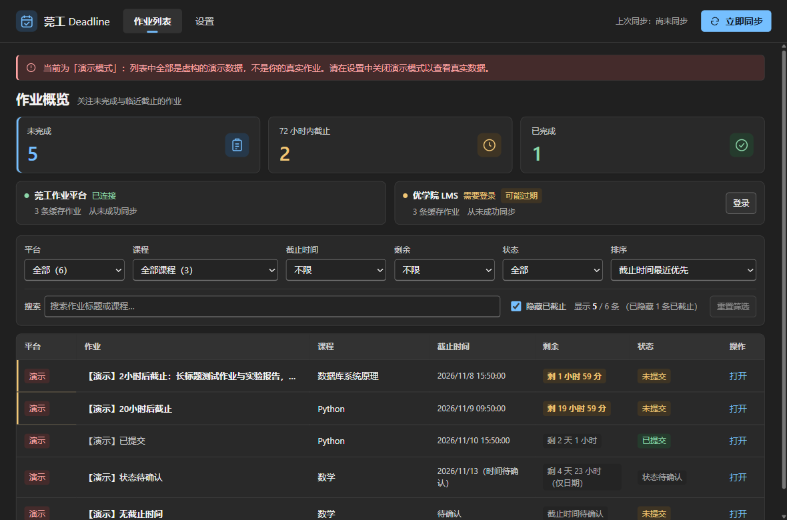

# 莞工 Deadline

一款 Windows 11 桌面端作业截止提醒工具，面向东莞理工学院学生。

只做三件事：**读取作业 → 展示与提醒 → 跳转源站**。
不接 AI、不接云服务器、不需要 API Key、不上传任何数据。

---

## 当前状态（2026-11-08）

| 能力 | 状态 |
|---|---|
| **莞工作业平台**（hw.dgut.edu.cn）真实作业读取 | ✅ **已接通**，实测 20 条 |
| **优学院 LMS**（lms.dgut.edu.cn）真实作业读取 | ✅ **已接通**，实测 121 条 |
| 桌面界面（作业列表 / 统计 / 设置 / 深色模式） | ✅ |
| 截止提醒引擎 + Windows 通知 | ✅ 端到端验证 |
| 系统托盘 / 开机自启 / 休眠恢复 / 断网降级 | ✅ 端到端验证 |
| NSIS 安装包 | 支持本地构建；已有安装包早于本次 UI 改造，需重新构建以包含新版界面 |
| 一键验收 | ✅ **18/18 通过** |
| 列表筛选（平台/课程/截止/剩余/状态） | ✅ 默认只看未截止、截止最近优先 |
| 廉价强提醒（12h/6h/3h/1h 右下角弹窗 + 任务栏闪烁） | ✅ 可逐项开关 |

**实测总览**：两平台合计读取 **141 条真实作业**，其中 8 条未完成、
2 条在 72 小时内截止（已核实为真实作业）。

> 本项目遵守一条硬规则：**没有真实验证过的能力，绝不宣称已完成**。
> 平台调研的全部证据见 [docs/PLATFORM_FINDINGS.md](docs/PLATFORM_FINDINGS.md)。

---

## 两个平台的接入方式（均已完成）

### 莞工作业平台

中央认证 CAS OAuth2 登录 → 会话 cookie → `/api/student/plan` 与
`/api/student/homework` 读取作业。

**关键点**：`deadline` 字段是**布尔值**（是否设了截止），
真正的截止时间是 `deadlineDate`（"YYYY-MM-DD HH:mm"）。

### 优学院 LMS

比 hw 复杂得多，共三个坑（详见 [PLATFORM_FINDINGS §3](docs/PLATFORM_FINDINGS.md)）：

1. **登录入口已损坏**：`/sld/pc.html` 返回 404
2. **CAS 的 service 必须指向应用中心** `application.dgut.edu.cn/appapi/cas/fromcas`
   （认证中心只信任来自应用中心的请求）
3. **API 必须带 `Authorization` 请求头**（值取自 `AUTHORIZATION` cookie）+ `version: 1`
   只带 cookie 会返回 `{"code":2001,"message":"缺少访问token"}`

另外两个参数陷阱：作业接口参数是 **`ocId`** 不是 `courseId`；
课程接口 `ps=1` 会让服务端 500。

> 首次使用时需在受控 Edge 窗口中完成一次中央认证（含验证码），
> 之后会话会持久化在应用专属 profile 中。


---

## 快速开始（开发）

```bash
npm install
npm run typecheck    # 类型检查
npm test             # 单元测试（180 个用例）
npm run build        # 生产构建
npm run dev          # 启动开发版
```

> 注意：本机 shell 若设置了 `NODE_OPTIONS=--require worker-events.cjs`，会污染 Electron 启动。
> `scripts/*.mjs` 中已显式将其置空。

### Fluent UI 预览

深灰与蓝色强调色、紧凑统计卡片、平台状态、响应式筛选栏和作业表格；保留浅色与跟随系统主题。
下图为明确标识的**虚构演示数据**，不包含真实作业或账号信息。



源码构建 UI 回归：`npm run build` 后运行 `node scripts/fluent-ui-e2e.mjs`。
首次克隆不含依赖、构建产物、安装包、浏览器会话、调研原始响应或诊断导出。

## 使用流程

1. 启动应用。
2. 在「莞工作业平台」右侧点 **登录**，会在弹出的 Microsoft Edge 窗口打开学校中央认证页。
3. **由你本人**在窗口中输入账号密码完成登录（应用不接触你的密码）。
4. 回到主界面点 **立即同步**。
5. 作业列表按截止时间升序显示：平台、作业名、课程、截止时间、剩余时间、提交状态、打开源站。

登录状态由应用专属的浏览器配置目录保存（位于 `%APPDATA%/dgut-deadline/browser-profile`），
与你日常使用的浏览器完全隔离。

---

## 隐私与安全

- **不保存密码**。登录完全在 Edge 窗口内由你手工完成。
- **不导出凭证**。应用不读取、不打印、不落盘任何 Cookie / Token / Authorization 值。
- **只读**。只发 GET 请求，不提交作业、不修改学校系统任何数据。
- **本地优先**。作业缓存与设置保存在本机 `%APPDATA%/dgut-deadline/`，无云同步、无遥测。
- **无 AI**。运行时不调用任何模型或付费接口。
- 诊断导出功能只包含版本号、Edge 检测结果、状态统计，**不含**作业正文与凭证。

---

## 需要你做的事（无法由程序代替）

| # | 操作 | 目的 |
|---|---|---|
| 1 | 安装 `dist\莞工Deadline-0.1.0-setup.exe` | 使用正式版 |
| 2 | 点「莞工作业平台」的「登录」，在 Edge 里完成中央认证 | 该平台已可用（实测 20 条作业） |
| 3 | 如要用优学院：点「登录」打开融合门户 → 登录 → 点「优学院」图标 | 绕开 LMS 损坏的登录页 |
| 4 | 到「设置」点「发送测试通知」，确认能看到 Windows 弹窗 | 验证通知 |
| 5 | 关闭窗口，确认托盘图标还在；托盘菜单「退出」能真正退出 | 验证托盘 |
| 6 | 目视核对 2–3 条作业的截止时间与提交状态 | 验证归一化正确 |


---

## 文档

| 文档 | 内容 |
|---|---|
| [AGENTS.md](AGENTS.md) | 开发约定与红线（接手前必读） |
| [docs/PLATFORM_FINDINGS.md](docs/PLATFORM_FINDINGS.md) | 平台调研：真实接口、字段语义、已验证/未验证项 |
| [docs/ARCHITECTURE.md](docs/ARCHITECTURE.md) | 架构设计与技术选型理由 |
| [docs/PRD.md](docs/PRD.md) | 产品需求 |
| [docs/PLAN.md](docs/PLAN.md) | 五阶段开发计划 |
| [docs/TASKS.md](docs/TASKS.md) | 任务清单与进度 |
| [docs/DECISIONS.md](docs/DECISIONS.md) | 技术决策记录（ADR） |
| [docs/TESTING.md](docs/TESTING.md) | 测试报告与证据 |
| [docs/FEATURES-FILTER-REMINDER.md](docs/FEATURES-FILTER-REMINDER.md) | 筛选与强制提醒功能说明 |
| [docs/RELEASE.md](docs/RELEASE.md) | 打包与发布说明 |

---

## 技术栈

Electron 38 · Vue 3 · TypeScript 5.9 · Vite 7 · electron-vite · Playwright Core（调用本机 Edge）
· electron-store · Vitest · electron-builder

设计原则：**真实可用优先于演示效果**。
